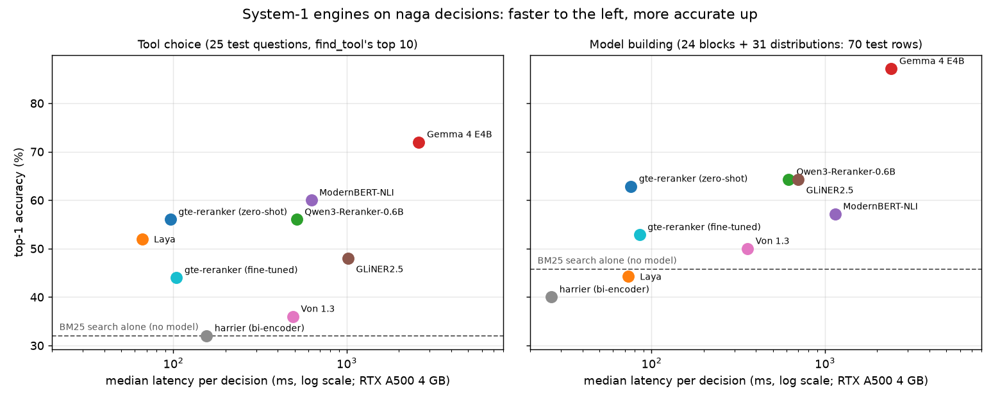
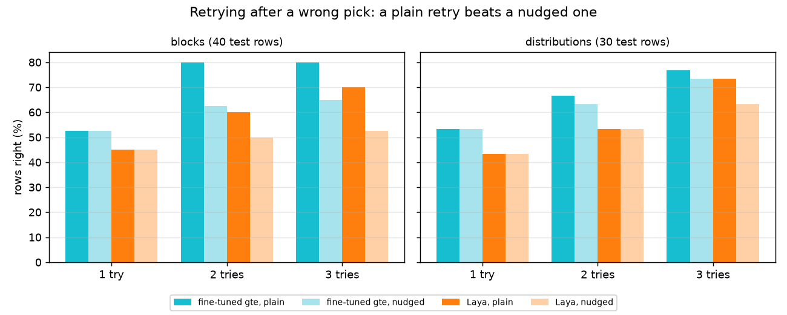
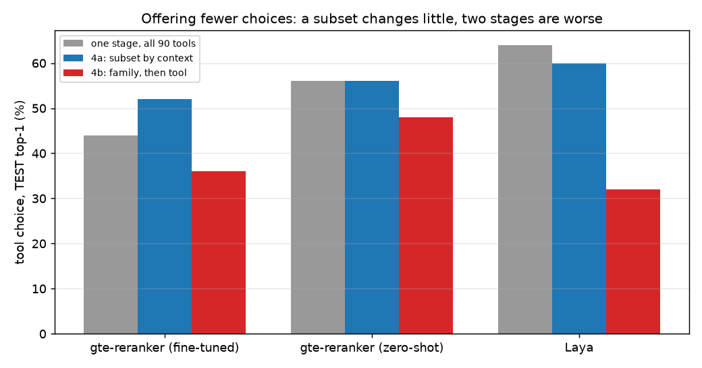

# Which System-1 model for naga decisions?

This study compares fifteen ways of making the small, frequent decisions an assistant faces while it drives the [naga](https://github.com/TheMattHub/naga) simulation engine, so you can pick the model that fits your own mix of speed, accuracy and hardware. Every number comes from [bench/naga/RESULTS.md](../../bench/naga/RESULTS.md), and the raw per-decision results sit next to it. The short answer is in [Which model should I pick](#which-model-should-i-pick); the sections before it say how far to trust it.

<noscript></noscript>

The grey step line is the Pareto frontier: the engines that no other engine beats on both speed and accuracy. Point at an engine, or at a kind in the legend, to see that kind's own frontier.

## The question

A System-1 model answers a multiple-choice question fast, without writing text. Naga's assistant needs four kinds of such answers:
- **Tool choice:** which of naga's 90 agent tools fits a plain-language request (re-ranking the 10 candidates that naga's own `find_tool` returns, or choosing among all 90).
- **Block type:** which of 24 block types a described step needs (CREATE, PROCESS, DELAY, DECIDE ...).
- **Distribution:** which of 31 distributions fits a described quantity.
- **Record field:** which field of a study record a phrase belongs to (16 usable rows; reported in RESULTS.md only).

The comparison is only fair if no model has seen the answers, which is why the test sets are frozen.

## Test sets

The test sets were written blind and frozen, and no engine, threshold or description was tuned against them. Where a set had to be used for tuning, it is called TRAIN and is never quoted as a result.

- **Tool choice (T):** TRAIN is 54 questions from naga's `tests/test_toolsearch.py` (`EVAL` plus `HELD_OUT`); TEST is the 25 questions of `HELD_OUT_2`, written on 2026-10-19 by an agent that saw only the tool names, never the descriptions. A re-ranker cannot beat its candidate list: `find_tool`'s top 10 holds the right tool for 19 of the 25 TEST questions, and choosing among all 90 tools lifts that ceiling.
- **Model building (B):** 40 block questions, 30 distribution questions and 30 field questions (16 kept after the corrections in [CORRECTIONS.md](../../bench/naga/data/CORRECTIONS.md)), written on 2026-10-19 by a model that saw only the block and distribution names. All of them are TEST.
- **Labels:** each question lists every acceptable answer, and top-1 or top-3 counts a hit when any of them is there.

Round 2 reran everything after naga's block and distribution descriptions were made fuller (the engines read those descriptions as the label texts), with the same questions.

## Engines and hardware

All local runs used one laptop with an RTX A500 (4 GB), seed 0, and the wall-clock time per decision as latency; Haiku's latency is the API round trip from that laptop. Licences and sizes are from each model card or repository (checked 2026-10-20).

| Engine | Model | Size | Licence | How it was used |
|---|---|---|---|---|
| baseline | naga's BM25 tool search | none | Apache-2.0 | `find_tool`'s order; token overlap for B |
| harrier-bi | `microsoft/harrier-oss-v1-270m` | 270M | MIT | bi-encoder; also made the top-20 shortlists |
| gte-rerank | `Alibaba-NLP/gte-reranker-modernbert-base` | 150M | Apache-2.0 | cross-encoder, zero-shot |
| qwen3-rerank | `Qwen/Qwen3-Reranker-0.6B` | 0.6B | Apache-2.0 | the model card's yes/no prompt |
| nli | `tasksource/ModernBERT-large-nli` | 396M | Apache-2.0 | zero-shot classification pipeline |
| gliner2 | `fastino/GLiNER2.5-Decide` | 486M | Apache-2.0 | classification with label descriptions |
| laya | `convaiinnovations/laya` (`typed-decisions`) | 421M | Apache-2.0 | through this gateway's Laya provider; at most 20 options |
| von | Von 1.3 (`von-sdk`, github.com/wfzyx/von) | not stated | Apache-2.0 (repository) | criteria as `{label: document}` |
| gemma4 | `unsloth/gemma-4-E4B-it-GGUF` (Q4_K_M of `google/gemma-4-E4B-it`) | 8.0B with embeddings ("E4B") | Apache-2.0 (model card tag) | through Ollama; options as letters, one letter back, probabilities from logprobs |
| tuned | gte-reranker fine-tuned by us | 150M | Apache-2.0 | listwise loss on T TRAIN; not published |
| d1-omni | `LiquidAI/d1-omni-600M` (GGUF F16) | 587M | LFM Open License v1.0 (commercial use below USD 10 M revenue) | llama.cpp `llama-server`, `/v1/systemone`, all options (round 3) |
| d1-3b | `LiquidAI/d1-3B` (GGUF Q8_0) | 3.12B | LFM Open License v1.0 (commercial use below USD 10 M revenue) | as d1-omni; its 16-bit weights do not fit 4 GB (round 3) |
| openthai | `iapp/OpenThai-SystemOne` | 0.8B | Apache-2.0 | its own client, all options; its Ollama build through the ollama provider as a second row (round 3) |
| anyjev | AnyJev 0.3.0 `Decider` (Nokia) over `Qwen/Qwen3-1.7B` in 4 bits | 1.7B | Apache-2.0 | training-free L0, two rotations, at most 26 options (round 3) |
| haiku | Claude Haiku 5.5 (`claude-haiku-5-5`, Anthropic API) | not published | commercial API | hosted; every option with its document in one cached prompt, its three best names back through one forced tool call |

Dropped for time or licence: a second LLM (Qwen3-4B), `jina-reranker` (non-commercial licence) and other embedding models. Naga itself uses `gte-reranker-modernbert-base` as an optional tool picker, off by default.

## Round 1

Round 1 used naga's original one-line block and distribution descriptions. For tool choice, re-ranking `find_tool`'s top 10 gave this (TEST is the honest column; TRAIN is shown for comparison):

| Engine | TRAIN top-1 | TEST top-1 | TEST top-3 | Median ms |
|---|---|---|---|---|
| baseline | 44/54 | 8/25 | 14/25 | 0 |
| harrier-bi | 37/54 | 8/25 | 16/25 | 155 |
| gte-rerank | 42/54 | 14/25 | 17/25 | 96 |
| qwen3-rerank | 44/54 | 14/25 | 19/25 | 513 |

Gemma 4 E4B reached 18/25 top-1 and 19/25 top-3 at 2.1 s, the tuned gte 15/25 and 18/25 at 105 ms, zero-shot NLI 15/25 and Laya 13/25 at 65 ms. For model building only Gemma was reliable (blocks 33/40, distributions 28/30, fields 15/16); the encoders read one-line texts such as "Entity source." and could not tell the blocks apart.

## Round 2

Fuller descriptions lifted the encoders on model building a lot and left tool choice unchanged, because the tool texts barely changed. Tool choice was also run over all 90 tools (Laya and Gemma got the harrier top 20 as options; Von got all 90 and fell apart).

**Tool choice, TEST (25 questions)**

| Engine | Top 10: top-1 / top-3 | ms | All 90: top-1 / top-3 | ms |
|---|---|---|---|---|
| baseline | 8 / 14 | 0 | 8 / 14 | 0 |
| harrier-bi | 8 / 16 | 155 | 8 / 12 | 27 |
| gte-rerank | 14 / 17 | 96 | 14 / 19 | 1130 |
| qwen3-rerank | 14 / 19 | 513 | 15 / 22 | 5392 |
| nli | 15 / 17 | 624 | 14 / 18 | 5160 |
| gliner2 | 12 / 16 | 1015 | 14 / 18 | 6458 |
| laya | 13 / 17 | 66 | 16 / 18 | 66 |
| von | 9 / 16 | 488 | 2 / 8 | 17361 |
| gemma4 | 18 / 19 | 2604 | 19 / 19 | 3042 |
| tuned | 11 / 17 | 104 | 11 / 16 | 1067 |
| haiku | 19 / 19 | 923 | 22 / 23 | 964 |

Over all 90 tools top-3 rises for the fast rerankers (gte 17 to 19, qwen3 19 to 22), because the six questions that `find_tool`'s top 10 misses become reachable. Top-1 stays flat, TRAIN top-1 falls (gte 42 to 39, qwen3 44 to 40), and latency grows tenfold or more.

**Model building, TEST (accuracy, round 1 to round 2)**

| Engine | Blocks (40) | Median ms | Distributions (30) | Median ms |
|---|---|---|---|---|
| baseline | 11 to 15 | 0 | 11 to 17 | 0 |
| harrier-bi | 5 to 15 | 27 | 12 to 13 | 26 |
| gte-rerank | 17 to 25 | 75 | 9 to 19 | 91 |
| qwen3-rerank | 19 to 24 | 591 | 17 to 21 | 754 |
| nli | 21 to 21 | 1134 | 12 to 19 | 1430 |
| gliner2 | 13 to 25 | 693 | 17 to 20 | 834 |
| laya | 9 to 18 | 65 | 15 to 13 | 75 |
| von | 23 to 22 | 356 | 8 to 13 | 359 |
| gemma4 | 33 to 34 | 2455 | 28 to 27 | 2316 |
| tuned | 13 to 21 | 83 | 11 to 16 | 113 |
| haiku | - to 37 | 906 | - to 30 | 876 |

Laya and Gemma saw the harrier top 20 as a shortlist; Von saw all labels. Gemma made one format error on tool choice (it answered "I" instead of a letter), counted as a miss.

## A hosted model

A small hosted model beat every local engine on every task, at under a second per decision. Claude Haiku 5.5 (run 2026-10-20, round 2 only) got 22 of 25 tool questions right over all 90 tools, 37 of 40 blocks and all 30 distributions, against Gemma's 19, 34 and 27; over `find_tool`'s top 10 it reached the ceiling of 19. It read about 2,000 prompt tokens per decision (12,400 over all 90 tools, most of them cached across questions) and wrote about 50. The price is a network call: every request goes to Anthropic, it needs an API key and a connection, and it is billed per token, so it suits a hosted assistant better than an offline one.

## Retries

When a pick is known to be wrong, asking again after removing the rejected label is cheap and works; adding the rejected labels' summaries to the query does not. In this study a pick counted as wrong when it was not in the gold answers, so the retry numbers are what you get when something (you, a validator) rejects wrong picks, not what a model achieves alone. With a plain retry the ranking reached its oracle within three tries (fine-tuned gte on blocks 21 to 32 of 40, Laya 18 to 28). A nudged retry, which adds "(not: label: summary)" to the query, never beat a plain retry and often lost (blocks 26 against 32 for the tuned gte, 21 against 28 for Laya), so the extra text misled the encoders. The cost is small: a plain retry on blocks averages 139 ms per request for the tuned gte and 167 ms for Laya.

## Fewer choices (phase 4)

Offering the model fewer choices did not pay on tool choice. A subset picked by context (4a) changed little on TEST (fine-tuned gte 11 to 13, zero-shot gte 14 to 14, Laya 16 to 15, top-1 out of 25) and helped TRAIN a little for the zero-shot gte and Laya. Two stages, family first and then tool (4b), were worse than a single stage over all 90 because family mistakes compound (end-to-end top-1 of 9, 12 and 8 for tuned gte, gte and Laya). Merging near-duplicate tools (4c) added at most one right answer, on the `twin_read` group.

## Tuning

Fine-tuning the smallest tunable cross-encoder helped a little in cross-validation and did not hold on TEST. The model (gte-reranker, 150M) was trained with a listwise loss on T TRAIN, with `find_tool`'s top 10 as hard negatives, 211 synthetic queries made from the tool descriptions and 20 block-docstring pairs, and never on a TEST row. Grouped 2-fold cross-validation on TRAIN went from 42 to 45 of 54 (top 10) and from 39 to 41 (all 90). On TEST, round 1's tuned model went from 14 to 15 of 25 on tool choice, while round 2's retuned model scored 11 of 25 and did not help model building either. Zero-shot is the safer default, since 25 test questions do not justify shipping a fine-tune.

## A local picker trained by a teacher

Training the fast reranker on a strong teacher's labels brought it close to that teacher on a new test set, and only the stronger teacher did it. The student is the same gte-reranker (150M), trained with the recipe above on 1,067 generated requests over all 90 tools, each labelled by a teacher: Claude Haiku 5.5 through the API, or Gemma 4 E4B locally. Matteo chose to train on Haiku's labels, and each row below names the teacher behind it. The test set, TEST2, is 100 new requests written from the 90 tool names only and frozen before any teacher or student saw it; HELD_OUT_2 is the round-2 TEST set of 25. The value of the stronger model is plain in the numbers: Haiku's labels lifted the student, Gemma's did not.

| engine | TEST2 all 90: top-1 / top-3 | TEST2 top10: top-1 / top-3 | HELD_OUT_2 all 90: top-1 / top-3 | median ms (all 90 / top10) |
|---|---|---|---|---|
| `find_tool` alone | 36 / 51 | 36 / 51 | 8 / 14 | 1 / 1 |
| gte, untuned | 58 / 80 | 53 / 75 | 14 / 19 | 1,191 / 109 |
| gte trained on Gemma's labels | 50 / 86 | 63 / 79 | 10 / 17 | 1,191 / 109 |
| gte trained on Haiku's labels | 80 / 92 | 70 / 78 | 15 / 18 | 1,189 / 110 |
| Gemma 4 E4B (teacher) | 69 / 82 | 67 / 77 | 19 / 19 | 3,223 / 2,390 |
| Claude Haiku 5.5 (teacher, API) | 82 / 95 | 76 / 80 | 22 / 23 | 1,002 / 950 |

The Haiku student gets within two questions of its teacher on TEST2 and runs locally. Over all 90 tools it is right first time on 80 of 100 requests against Haiku's 82 and the untuned gte's 58, and over `find_tool`'s top 10 it gets 70 at 110 ms, where the ceiling is 80. Gemma's student fell below the untuned gte over all 90 (50 of 100) because its labels were noisier: Gemma's first choice matched the generated request's tool on 838 of 1,067 requests, Haiku's on 943. On the 106 held-out training requests the Haiku student agreed with its teacher on 80 and the Gemma student with its teacher on 58. The stronger teacher made the better student, and by a wide margin.

The gain does not carry over to the older 25 questions, which is the main caveat. On HELD_OUT_2 the Haiku student scores 15 of 25 over all 90 tools against the untuned gte's 14 and Haiku's 22. The training requests and TEST2 were both written by Claude Sonnet 5.5, so part of the TEST2 gain is probably the shared style of the requests rather than knowledge of the tools. A test set written by people would settle it.

The cost was small. Haiku's 1,067 labels took about 13.3 million input tokens, most of them the cached block of 90 tool documents, and 56,000 output tokens, in 20 minutes of API time. Gemma's labels took 57 minutes on the laptop GPU, and each student trained in 27 minutes. Full tables, the plain-retry line and the notes are in [RESULTS.md](../../bench/naga/RESULTS.md#distillation-2026-1020-21).

### A test written by four other models (round 4)

The student's gain holds on requests that Claude Sonnet did not write. TEST3 is 150 new requests written by four other models, each given only the 90 tool names and the tool to ask for, and frozen before any picker saw it: Claude Opus 5.5, Gemma 4 E4B, Qwen3-1.7B and Liquid AI's d1-3B. Two new students joined, one trained on Claude Opus 5.5's labels (Opus beat Haiku on TEST3 by 12 requests, enough to pass the gate for paying for its labels) and one on the 936 training requests where Haiku and Opus both named the generated tool. The table is top-1 over all 90 tools, per writer and in total.

| engine | Opus (38) | Gemma (40) | Qwen3 (34) | d1-3B (38) | TEST3 (150) | TEST3 top-3 | TEST2 | HELD_OUT_2 | median ms |
|---|---|---|---|---|---|---|---|---|---|
| `find_tool` alone | 6 | 4 | 11 | 15 | 36 | 63 | 36 | 8 | 0 |
| gte, untuned | 17 | 19 | 17 | 22 | 75 | 99 | 58 | 14 | 1,228 |
| gte trained on Haiku's labels | 26 | 25 | 19 | 26 | 96 | 123 | 80 | 15 | 1,221 |
| gte trained on Opus's labels (new) | 31 | 26 | 21 | 26 | 104 | 128 | 79 | 16 | 1,197 |
| gte trained on agreed labels (new) | 27 | 23 | 20 | 29 | 99 | 130 | 81 | 17 | 1,200 |
| Gemma 4 E4B | 23 | 18 | 18 | 25 | 84 | 103 | 69 | 19 | 3,273 |
| d1-3B, Q8_0 | 28 | 26 | 18 | 26 | 98 | 118 | 73 | 19 | 13,667 |
| Claude Haiku 5.5 (API) | 23 | 22 | 18 | 23 | 86 | 117 | 82 | 22 | 935 |
| Claude Opus 5.5 (API) | 27 | 27 | 19 | 25 | 98 | 128 | 86 | 23 | 2,038 |

Every student beats the untuned gte on every writer, so the TEST2 gain was not only Sonnet's style. On TEST3 the students even beat their teachers (Opus student 104 against Opus 98, Haiku student 96 against Haiku 86), probably because they learned the tool a request was written for, while the language models pick what the tool documents fit best when a request is loosely worded. The best local picker is now the student trained on Opus's labels: 104 of 150 at 1.2 s, against 98 for d1-3B at 13.7 s and 84 for Gemma. Opus's 1,067 labels cost about USD 4.70 with the cached tool documents. Two cautions remain: on the older HELD_OUT_2 every student still sits at 15-17 of 25 against Haiku's 22, and the small writers add noise (on Qwen3-1.7B's rows every engine scores 18-21 of 34, and 12 TEST3 requests do not fit their target, listed in the notes). Full tables are in [RESULTS.md](../../bench/naga/RESULTS.md#round-4-a-multi-writer-test-2026-10-21).

### Queries as the agent writes them (round 5)

When Claude Opus 5.5 is the agent, it sends `find_tool` a short search phrase of its own, so round 5 measured the pickers on that style. AGENT3 is 274 such phrases: Opus got each TEST3, TEST2 and HELD_OUT_2 request with naga's real server instructions and `find_tool` as its only tool, and the query of its first call became the row, frozen before any picker saw it. In our setup the backup ranks every tool, so all 90 is the mode that decides.

| engine | all 90: top-1 / top-3 (of 274) | ms | top10: top-1 / top-3 | ms |
|---|---|---|---|---|
| `find_tool` alone | 136 / 190 | 0 | 136 / 190 | 0 |
| gte, untuned | 161 / 201 | 1,127 | 163 / 202 | 90 |
| gte trained on Haiku's labels | 178 / 211 | 1,128 | 180 / 207 | 93 |
| gte trained on Opus's labels | 183 / 215 | 1,129 | 180 / 207 | 92 |
| gte trained on agreed labels | 183 / 219 | 1,127 | 181 / 206 | 93 |
| Claude Haiku 5.5 (API) | 190 / 216 | 966 | 183 / 208 | 922 |
| Claude Opus 5.5 (API) | 190 / 225 | 1,741 | 180 / 208 | 1,998 |

Haiku should go first and the Opus-trained gte should back it up, but the margin is small. Haiku is right first time on 190 of 274 against 183 for the student, 2.6 points; it wins 15 rows the student loses and loses 8 the student wins, which is within noise (sign test p = 0.21). Both answer in about a second, Haiku costs under USD 0.0013 a decision, and the student is free and works offline. Opus as the picker matches Haiku's top-1 at twice the time, and writing AGENT3 plus its picker runs cost USD 5.23. Full tables, by source and by writer, are in [RESULTS.md](../../bench/naga/RESULTS.md#round-5-queries-as-the-agent-writes-them-2026-10-21).

## Round 3: new System-1 models

One new decision model matched the best local LLM, and it came with a licence limit. Round 3 ran four new System-1
engines on TEST2 (100 requests) and on the round-2 model-building sets, and reran every earlier engine whose run was
cheap on TEST2. The tool-choice columns are TEST2, top-1 out of 100; model building is top-1 out of 40 and 30.

| engine | TEST2 top10 | ms | TEST2 all 90 | ms | blocks | distributions | ms |
|---|---|---|---|---|---|---|---|
| `find_tool` alone | 36 | 1 | 36 | 1 | 15 | 17 | 0 |
| gte, untuned | 53 | 109 | 58 | 1,191 | 25 | 19 | 75 |
| gte trained on Haiku's labels | 70 | 110 | 80 | 1,189 | - | - | - |
| Qwen3-Reranker-0.6B | 61 | 520 | 64 | 5,849 | 24 | 21 | 591 |
| Laya | 52 | 65 | 52 | 66 | 18 | 13 | 65 |
| d1-omni-600M (new) | 52 | 47 | 43 | 364 | 16 | 8 | 110 |
| d1-3B, Q8_0 (new) | 69 | 1,377 | 73 | 13,676 | 33 | 28 | 1,096 |
| OpenThai-SystemOne (new) | 55 | 556 | 7 | 16,621 | 23 | 23 | 339 |
| AnyJev on Qwen3-1.7B (new) | 25 | 1,454 | 21 | 2,461 | 12 | 16 | 1,115 |
| Gemma 4 E4B | 67 | 2,390 | 69 | 3,223 | 34 | 27 | 2,455 |
| Claude Haiku 5.5 (API) | 76 | 950 | 82 | 1,002 | 37 | 30 | 906 |

Liquid AI's d1-3B ties Gemma 4 E4B on every task (73 against 69 over all 90 tools, 33 against 34 blocks, 28 against
27 distributions) with no format errors, at half Gemma's time on short option lists. Over all 90 tools it takes 13.7 s
on this 4 GB GPU, and its licence allows commercial use only below USD 10 M annual revenue. The smaller d1-omni-600M is
the fastest System-1 model here (47 ms) but no better than the untuned gte. OpenThai-SystemOne is a fair Apache-2.0
choice for short lists and fails over 90 long options; its Ollama build, asked through the gateway's letter prompt,
is much worse, because it was tuned for Ollama's own prompt. AnyJev's training-free layer on a 1.7B base stays below
`find_tool` alone: the layer removes order bias but cannot add knowledge the base lacks. Every other row, the numbers
for NLI, GLiNER2.5, Von, harrier and the round-1 fine-tune, and what was skipped (JEV-9B, Jeva) are in
[RESULTS.md](../../bench/naga/RESULTS.md#round-3-2026-10-21).

## Which model should I pick

Pick by the cost of a wrong answer and of waiting. All times are medians per decision on the laptop above.

| You need | Pick | What you get | Trade-off |
|---|---|---|---|
| Fast | `Alibaba-NLP/gte-reranker-modernbert-base`, zero-shot | tool choice 14/25 at 96 ms; blocks 25/40 at 75 ms; distributions 19/30 at 91 ms | Laya is faster on tool choice only; no faster engine matches it on model building |
| Most accurate, local | Gemma 4 E4B (Q4_K_M via Ollama) | tool choice 18/25 (19/25 over all 90), blocks 34/40, distributions 27/30 | 2.3 to 3 s per decision; one format error in 25 tool questions |
| In the middle | `Qwen/Qwen3-Reranker-0.6B` | tool choice 14/25 top-1 and 19/25 top-3 at 0.5 s; blocks 24/40 and distributions 21/30 at 0.6 to 0.75 s | Over all 90 tools it takes 5.4 s |
| Most accurate, hosted | Claude Haiku 5.5 through the Anthropic API | tool choice 22/25 over all 90 (19/25 over the top 10, the ceiling); blocks 37/40; distributions 30/30; about 0.9 s | Needs an API key and a network; requests leave your machine; billed per token |
| A System-1 model as accurate as Gemma | `LiquidAI/d1-3B` (GGUF Q8_0 via llama.cpp) | TEST2 73/100 over all 90 tools, blocks 33/40, distributions 28/30, no format errors | 1.1 s on short lists, 13.7 s over all 90 on 4 GB; commercial use only below USD 10 M revenue |
| Tool choice only | Laya `typed-decisions` | 13/25 over `find_tool`'s top 10 (16/25 over all 90 with a shortlist) at 66 ms | Weak on model building (blocks 18/40, distributions 13/30); at most 20 options |

If a wrong pick is cheap to catch and retry, the fast model closes part of the gap (see Retries); if it is expensive, take Haiku when a hosted call is acceptable and Gemma when it is not.

## Caveats

These results are a first measurement, not a verdict. The sets are small (25 TEST questions for tool choice, 40 blocks, 30 distributions), so one question is 4 points on tool choice and a difference of one or two rows means nothing. Everything ran on one laptop, so latencies move with your GPU, and Gemma's speed in particular depends on Ollama and your hardware. Models ran out of the box with the prompts described in RESULTS.md, and a better prompt or more training data may change the order. No fast engine gave a confidence threshold that held on TEST (Laya 21/25 covered at 62% right, the tuned gte 23/25 at 61%), so none of them knows when it is wrong; Gemma covered 20/25 tool questions at 85%.

## Rerun it

The bench is in [bench/naga](../../bench/naga/README.md), and it runs against a clone of the public [naga](https://github.com/TheMattHub/naga) repository. Clone naga next to this repo, then run `powershell -ExecutionPolicy Bypass -File bench/naga/run.ps1` (add `-Round 2` for round 2 and `-Only <engine>` for one engine). To add an engine, copy the closest `eng_*.py`, write one JSONL file per task in `results2/`, and rebuild the tables with `report2.py` and the charts with `plot.py`.
